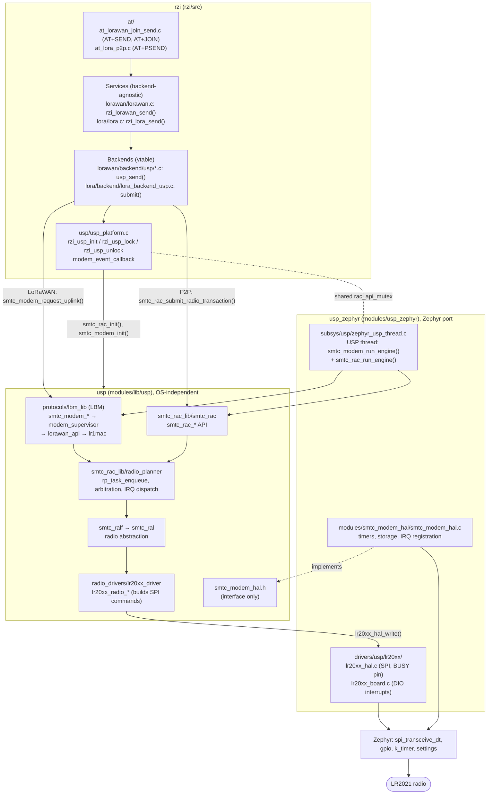
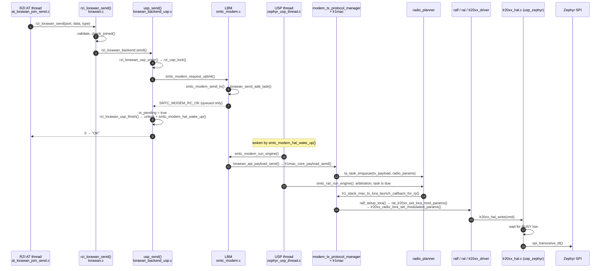
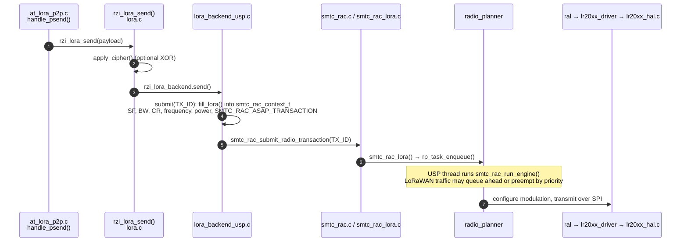
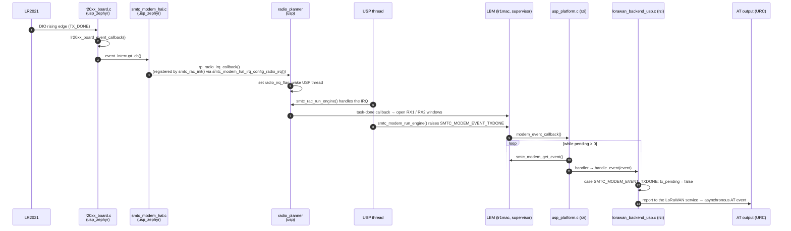

# USP stack

Status: implemented

How RZI sits on top of Semtech USP (`modules/lib/usp`) and its Zephyr port
(`modules/usp_zephyr`), with three call chains traced through real functions.

See also: [architecture.md](./architecture.md),
[lorawan-backends.md](./lorawan-backends.md),
[lora-api.md](./lora-api.md),
[at-framework.md](./at-framework.md).

## Repositories

| Repository | Path | Role | Zephyr-specific |
|---|---|---|---|
| `rzi` | `rzi/` | Product application: AT commands, services, backends | Yes |
| `usp_zephyr` | `modules/usp_zephyr` | Zephyr module: HAL implementation, radio BSP, USP thread, Kconfig/CMake glue, boards, samples | Yes |
| `usp` | `modules/lib/usp` | Portable core: RAC, radio planner, RAL/RALF, chip drivers, protocols | No |

LoRa Basics Modem (LBM) is not a separate repository. It is the protocol
library at `modules/lib/usp/protocols/lbm_lib`, and it runs on top of RAC.

`usp_zephyr/west.yml` pins `usp` (currently `v1.2.1`) at `modules/lib/usp`.
`usp` has no Zephyr build logic of its own:
`usp_zephyr/modules/usp/CMakeLists.txt` sets `RAC_LIB_DIR` and `LBM_LIB_DIR`
and picks the sources to compile from Kconfig. LBM is compiled only with
`CONFIG_USP_LORA_BASICS_MODEM=y`.

`usp` declares the HAL interface (`smtc_modem_hal.h`).
`usp_zephyr/modules/smtc_modem_hal/` implements it. Porting to another OS
means rewriting only that layer and the radio BSP.

## Layers

LoRaWAN goes through LBM. Raw LoRa / FSK (P2P) skips LBM and submits
transactions straight to RAC. LBM and the RZI P2P backend are therefore peer
RAC users that queue in the same radio planner.

| Layer | Repository | Example functions | Owns |
|---|---|---|---|
| AT commands | rzi | `handle_psend()` | Parsing, `OK` / `ERROR` replies |
| Services | rzi | `rzi_lorawan_send()`, `rzi_lora_send()` | Validation and state; backend-agnostic (USP, Zephyr, test) |
| Backends | rzi | `usp_send()`, `submit()` | Mapping RZI semantics to Semtech APIs, locking |
| Platform | rzi | `rzi_usp_lock()`, `modem_event_callback()` | USP init, mutual exclusion with the USP thread, LBM event dispatch |
| LBM | usp | `smtc_modem_request_uplink()` → `lr1mac_core_payload_send()` | LoRaWAN MAC |
| RAC and radio planner | usp | `smtc_rac_submit_radio_transaction()`, `rp_task_enqueue()` | Multi-protocol arbitration and scheduling |
| RAL and drivers | usp | `ralf_setup_lora()` → `lr20xx_radio_lora_set_modulation_params()` | Radio parameters to chip commands |
| Zephyr port | usp_zephyr | `lr20xx_hal_write()`, USP thread, `smtc_modem_hal_*` | SPI, GPIO, timers, thread, HAL implementation |
| OS | zephyr | `spi_transceive_dt()` | Peripheral access |

## Example 1: `AT+SEND` (LoRaWAN uplink)

The AT thread only queues the uplink. The USP thread drives the radio.

## Example 2: `AT+PSEND` (raw LoRa, no LBM)

Because both paths share the radio planner, `on_tx_done()` in
`lora_backend_usp.c` maps `RP_STATUS_TASK_ABORTED` (preempted by LoRaWAN or
cancelled by `stop()`) to `-RZI_ERR_BUSY`.

## Example 3: TX-done interrupt back to RZI

## Locking

Every `smtc_*` call from RZI must sit between `rzi_usp_lock()` and
`rzi_usp_unlock()`. The lock is `rac_api_mutex`, the same mutex the USP thread
holds around `smtc_modem_run_engine()` and `smtc_rac_run_engine()`, so
`usp_platform.c` enforces `BUILD_ASSERT(CONFIG_USP_THREADS_MUTEXES)`.
`rzi_usp_unlock()` also calls `smtc_modem_hal_wake_up()` so the USP thread
processes newly queued work immediately instead of waiting for its next
timeout.

`modem_event_callback()` and the handler installed with
`rzi_usp_set_event_handler()` run in the USP thread with the lock held. They
must not block on anything that waits for the USP thread.

## Relation to the usp_zephyr samples

`samples/usp/` in `usp_zephyr` is split by the layer each sample exercises:

| Directory | Uses | RZI equivalent |
|---|---|---|
| `lbm/` (for example `periodical_uplink`) | LBM `smtc_modem_*`; RAC runs underneath | `lorawan/backend/usp` |
| `rac/` (for example `multiprotocol`) | LBM and another protocol sharing the radio through RAC | LoRaWAN and P2P together |
| `sdk/` (for example `ping_pong`) | Raw modulations submitted to RAC, no LoRaWAN | `lora/backend/lora_backend_usp.c` |
